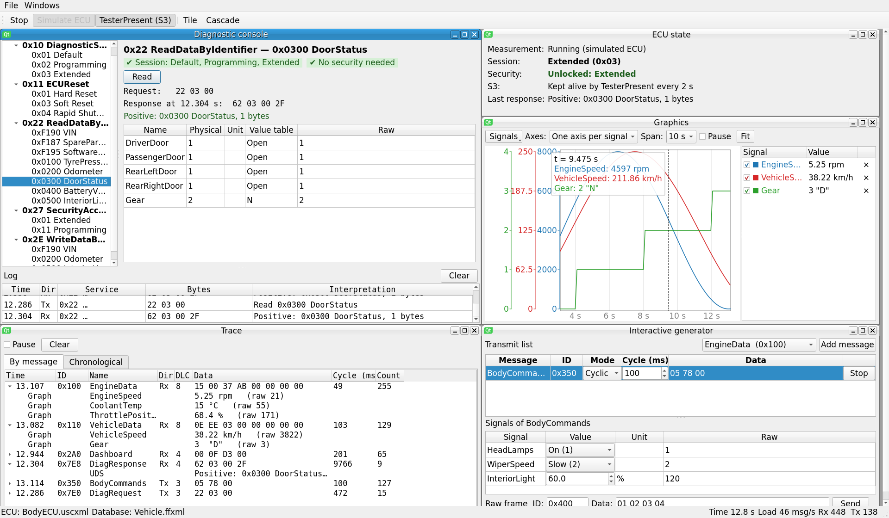
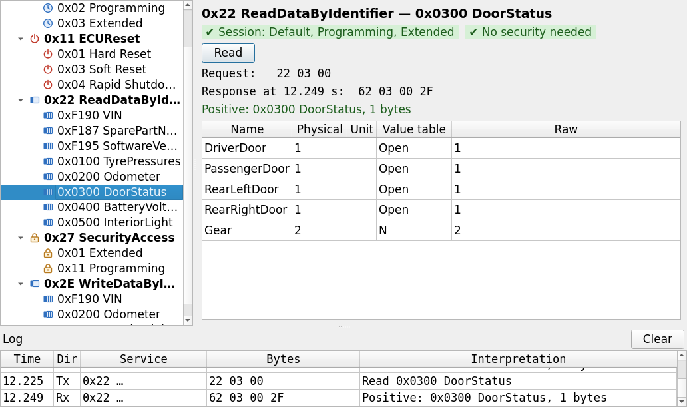
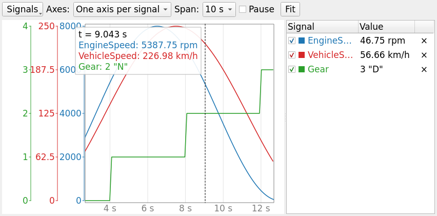
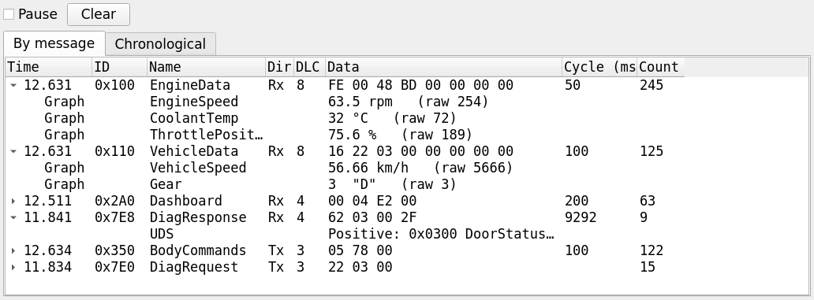
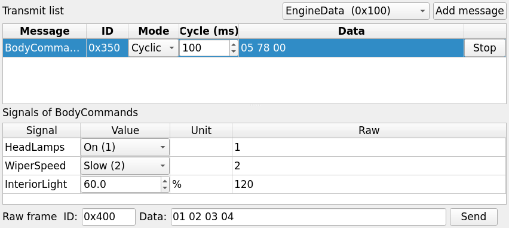
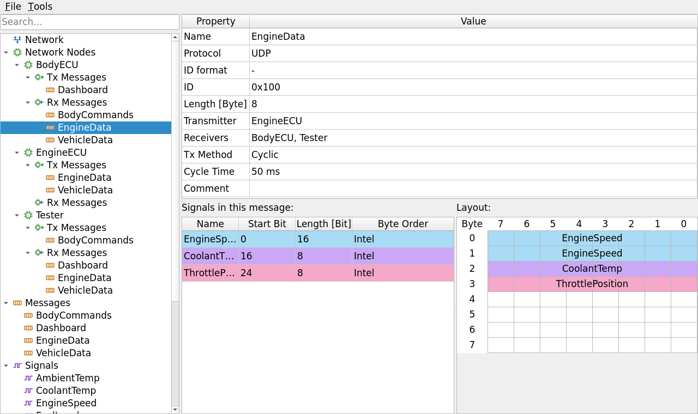
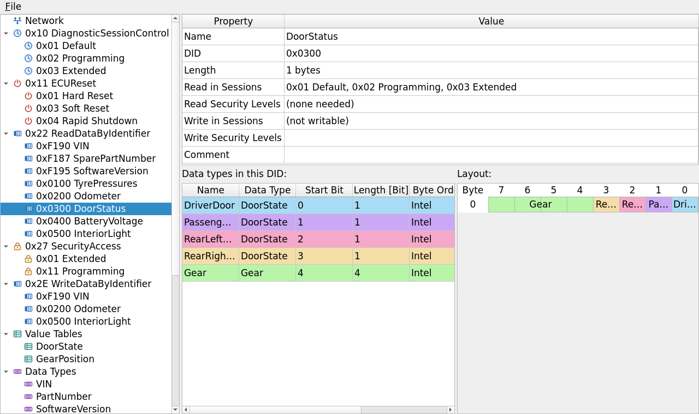

<h1 align="center">AutoForge</h1>

<p align="center">
  <b>An open automotive diagnostics toolchain, written in C++ and Qt.</b><br>
  Describe your bus messages, describe your ECU's UDS services, then talk to the ECU, all from three small desktop apps.
</p>

<p align="center">
  
  
  
  
  
  <a href="LICENSE"></a>
</p>

<p align="center">
  
</p>

---

## The toolchain

| App | What it does | Works on | Feels like |
|---|---|---|---|
| **FrameForge** | Message database editor: networks, nodes, messages, signals, value tables | `.ffxml` | Vector CANdb++ |
| **UDScribe** | Diagnostic description editor for **one ECU**: its UDS sessions, resets, security levels and data identifiers | `.uscxml` | Vector CANdelaStudio |
| **DiagProbe** | Active tester: sends UDS requests, decodes responses, traces and plots the bus, sends messages | both | Vector CANoe |

FrameForge and UDScribe each keep their data in a small, self-contained library (`ffcore` and `usccore`), and DiagProbe links both. A `.uscxml` never refers to a `.ffxml`: the diagnostic description stands on its own, so the ECU's UDS server can be written by hand straight from it.

---

## DiagProbe — the tester

DiagProbe is a desktop of movable windows. Start a measurement and it talks UDS to the ECU described in the `.uscxml`, while decoding all other bus traffic with the `.ffxml`. No hardware is needed to try it: tick **Simulate ECU** and DiagProbe starts an ECU of its own that answers exactly as the description says.

### Diagnostic console



Everything for talking to the ECU, in one window.

- **Request tree:** every session, reset, readable and writable DID and security level from the `.uscxml`. Double-click a request to send it.
- **Prerequisite chips:** what the request needs (session, unlocked level), green when met and red with the NRC the ECU **will** answer when not.
- **One click per service:** *Switch session*, *Reset ECU*, *Read*, *Write* (with an editable value table: physical numbers, value-table names, text or hex), and *Request seed and send key*, which does both steps.
- **Decoded responses:** raw, physical, unit and value-table text for every value in a DID. Each response says when it came (`Response at 11.570 s`) and flashes when it arrives, so a repeated identical answer is still seen as new.
- **Log:** every request and response with its meaning (`Negative: 0x33 securityAccessDenied`). Response pending (0x78) is shown in orange and NRCs in red. Click a line to jump to its request.

### Graphics



- Up to six signals in physical units, picked by message or with a Trace window's **Graph** button.
- Three axis modes: one axis per signal, one shared axis, or stacked lanes.
- **Wheel** zooms time, **Ctrl+wheel** zooms Y (over one axis: just that signal), **drag** pans, and **double-click** or **Fit** goes back to live.
- A hover cursor reads every value at that instant, value-table names included.

### Trace



- **By message:** one row per ID, updated in place with data, cycle time and count. Expand a row for its decoded signals.
- **Chronological:** every frame in order, with its meaning.
- UDS traffic shows up as `DiagRequest` / `DiagResponse`, explained.

### Interactive generator



Send `.ffxml` messages once or cyclically. Edit their signals in physical values or by value-table name; the payload follows at once. A raw frame row sends any ID and bytes. Messages the `Tester` node transmits are in the list from the start.

### Configurations

**File → Save Configuration** (Ctrl+S) stores the whole setup in a `.dpcfg` file:
- both files, relative to the configuration, so a project folder can move;
- every window's position, size and whether it is open;
- the plotted signals, axis mode and span;
- the generator's transmit list with modes, cycle times and signal values;
- the toolbar switches.

Open it again with **File → Open Configuration** or `DiagProbe setup.dpcfg`.

### Under the hood

- **UDS client:** waits P2, or P2* after `0x78` response pending, with the timing the ECU reports in its `0x50` response. It sends TesterPresent (`3E 80`) every 2 s outside the default session and follows S3, so it knows when the ECU has fallen back to default.
- **Simulated ECU:** built from the `.uscxml` alone.
  - Sessions with their own P2/P2*.
  - Security access with random seeds, a limit on wrong keys (then `0x36`, then a `0x37` lockout) and `0x24` for a key without a seed.
  - Resets back to default and locked.
  - DIDs kept in memory, so writes stick.
  - The NRCs `0x11 0x12 0x13 0x31 0x33 0x7E` where they belong.
  - Writes in the programming session answer `0x78` first, to exercise P2*.
  - Cyclic `.ffxml` messages with slowly moving signal values.
- **ECU state window:** current session, unlocked levels, S3 and the last response.

**Services supported today:** `0x10` DiagnosticSessionControl · `0x11` ECUReset · `0x22` ReadDataByIdentifier · `0x27` SecurityAccess · `0x2E` WriteDataByIdentifier · `0x3E` TesterPresent. More are added as the project goes.

---

## FrameForge — the message database



- **Network:** CAN, CAN FD, UART or UDP, each with its own settings (bit rates and sample points, baud rate and CRC, addresses and ports).
- **Nodes:** with the messages each one transmits and receives.
- **Messages:** ID, length, transmitter and receivers, cyclic or on-event sending. A bit-level **layout** view shows where every signal sits.
- **Signals:** Intel or Motorola byte order (DBC bit numbering), signed / unsigned / IEEE float / double, factor, offset, unit, range and value table.
- **Search:** filters the navigation tree as you type.
- **Consistency check:** finds errors and probable mistakes across the whole database.

## UDScribe — the diagnostic description



One file describes one ECU: everything a tester needs to drive it, and everything a developer needs to write its UDS server by hand.

- **Network:** the protocol, plus the request and response IDs.
- **`0x10` sessions:** each with its own P2 and P2* (the default session is always there).
- **`0x11` reset types:** the sessions and security levels each one needs, and the power-down time for rapid shutdown.
- **`0x27` security levels:** seed and key lengths, maximum attempts, and the sessions each level can be unlocked in.
- **Data types:** reusable bit fields with byte order, scaling, unit, range and value table. ASCII and raw bytes are supported too.
- **Data identifiers:** fixed-length records that place data types at bit positions (the same type may be placed several times), with the sessions and levels needed to **read** (`0x22`) and to **write** (`0x2E`). A bit-level layout view shows them.

---

## Getting started

### Build

You need Qt 5.15 or Qt 6 (Widgets and Network) and a C++17 compiler.

```bash
git clone git@github.com:aslanlogic/AutoForge.git
cd AutoForge
mkdir build && cd build
qmake ../AutoForge.pro
make -j$(nproc)
```

Or open `AutoForge.pro` in Qt Creator and press Build. This builds `ffcore`, `usccore`, FrameForge, UDScribe and DiagProbe.

### Try it in one minute

1. Run **DiagProbe** (`build/DiagProbe/DiagProbe`).
2. **File → Open Examples** (Ctrl+E). This loads `examples/BodyECU.uscxml` and `examples/Vehicle.ffxml`.
3. Press **Start** (F9). *Simulate ECU* is on, so a simulated ECU answers on this PC.
4. Try a little scenario:
   - read **0xF190 VIN**;
   - try to write **0x0200 Odometer**: red chips, then `0x31`;
   - switch to **0x03 Extended**: `0x33` now;
   - unlock **0x01 Extended**;
   - write it again: it sticks.

You can also open the files straight from the command line:

```bash
DiagProbe examples/BodyECU.uscxml examples/Vehicle.ffxml
```

### The examples

| File | Contents |
|---|---|
| [`examples/Vehicle.ffxml`](examples/Vehicle.ffxml) | Nodes EngineECU, BodyECU and Tester; **EngineData** `0x100` (EngineSpeed, CoolantTemp, ThrottlePosition), **VehicleData** `0x110` (VehicleSpeed in Motorola order, Gear), **Dashboard** `0x2A0`, **BodyCommands** `0x350` (sent by the tester); value tables OnOff, WiperSpeed, GearPosition |
| [`examples/BodyECU.uscxml`](examples/BodyECU.uscxml) | Sessions Default / Programming / Extended; security levels Extended (`0x01`) and Programming (`0x11`); Hard, Soft and Rapid Shutdown resets; DIDs VIN, SparePartNumber, SoftwareVersion, TyrePressures (one type placed 4×), Odometer, DoorStatus (bits + gear), BatteryVoltage (Extended only), InteriorLight |

---

## On the wire

DiagProbe currently talks **UDP**. Every datagram carries one whole message:

```
[ message ID : idSize bytes, little-endian ] [ payload ]
```

- UDS requests use the `.uscxml` **request ID** (`0x7E0` in the example) and responses use the **response ID** (`0x7E8`). Bus messages use their `.ffxml` frame IDs.
- DiagProbe listens on `localPort` and sends to `remoteAddress:remotePort`; the simulated ECU uses the opposite pair.
- The **UART** framing that FrameForge and UDScribe describe is: `[ID][DLC][payload][CRC]`, COBS-encoded and ended with `0x00`, with CRC-8/16/32 in fixed, documented variants.

> **Security access key:** DiagProbe and its simulated ECU share a placeholder algorithm, `key[i] = seed[i mod n] XOR 0x5A XOR i`, in [`DiagProbe/diagdefaults.h`](DiagProbe/diagdefaults.h). Key algorithms are tester secrets, so they are deliberately not part of the `.uscxml`.

---

## Project layout

```
AutoForge/
├── ffcore/        library: message database model + .ffxml storage + consistency checker   (namespace ff)
├── usccore/       library: diagnostic description model + .uscxml storage                  (namespace usc)
├── FrameForge/    app: message database editor
├── UDScribe/      app: diagnostic description editor
├── DiagProbe/     app: tester, UDP bus, simulated ECU, windows
├── examples/      Vehicle.ffxml, BodyECU.uscxml
└── docs/          screenshots
```

Both file formats are plain, readable XML; their full structure is documented at the top of [`ffcore/xmlstorage.h`](ffcore/xmlstorage.h) and [`usccore/xmlstorage.h`](usccore/xmlstorage.h).

## Roadmap

- [ ] CAN on Linux: PEAK adapters / SocketCAN with ISO-TP
- [ ] UART transport in DiagProbe
- [ ] Pluggable security access key algorithms
- [ ] More UDS services, added one at a time
- [ ] UDP broadcast and multicast

## License

Copyright © 2026 aslanlogic.

AutoForge is free software: you can redistribute it and/or modify it under the terms of the **GNU General Public License** as published by the Free Software Foundation, either **version 3** of the License, or (at your option) any later version. It is distributed in the hope that it will be useful, but **without any warranty**; see [`LICENSE`](LICENSE) for the full text.

---

<sub>AutoForge is an independent project. It is not affiliated with or endorsed by Vector Informatik GmbH; product names are mentioned only to describe what each tool is similar to.</sub>
